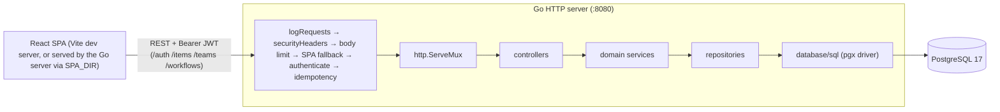
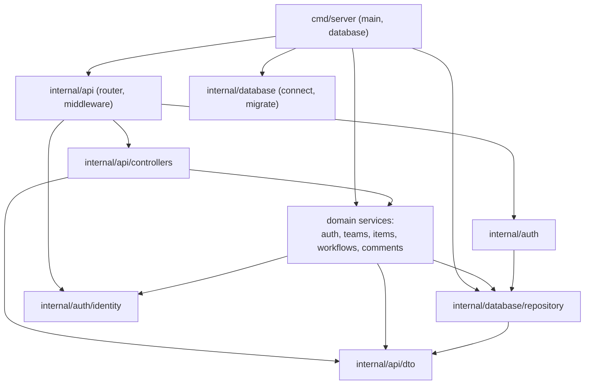
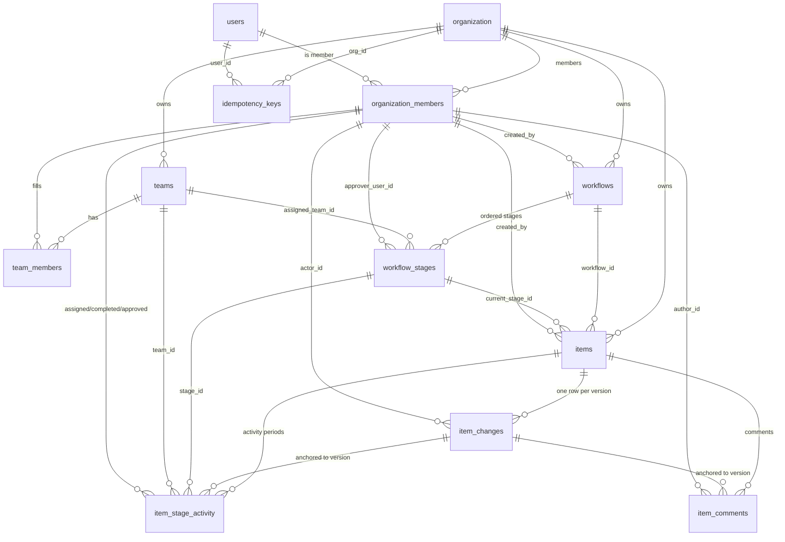
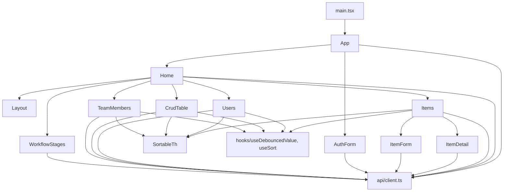

# Dependency Map

How the pieces of ScaleOfCoherence depend on each other: runtime topology,
backend layering, endpoint wiring, database foreign keys, frontend component
tree, and the cross-cutting rules that hold it all together.

See also [ENGINEERING_DECISIONS.md](ENGINEERING_DECISIONS.md) for the *why*, and
[README.md](README.md) for setup.

---

## 1. Runtime topology

- Every route except the public paths (`POST /auth/signup`, `POST /auth/login`,
  `GET /healthz`, `GET /readyz`) sits behind the `authenticate` middleware,
  which parses the JWT (HS256), re-reads the caller's org membership, and
  injects an `identity.Identity` into the request context.
- Authenticated `POST/PUT/PATCH/DELETE` requests under `/items` carrying an
  `Idempotency-Key` header run through the idempotency middleware
  (`internal/api/idempotency.go`), which replays stored responses or rejects
  conflicting retries.
- With `SPA_DIR` set (Docker image), non-API paths are served from the built
  frontend with an `index.html` fallback; API prefixes always go through
  `authenticate` first (`internal/api/handlers.go`).
- Migrations are embedded in the binary (`embed.go`) and applied at boot or via
  `-migrate-only` (`internal/database/postgres.go`).

---

## 2. Backend package dependencies

Import direction (arrows point to the dependency):

| Package | May import | Rule |
|---|---|---|
| `internal/api/dto` | stdlib only | Pure wire/scan types; no internal imports. |
| `internal/auth/identity` | stdlib only | Context key + identity value; no dependencies. |
| `internal/database/repository` | `dto`, `database/sql`, stdlib | Talking to Postgres and mapping rows to DTOs. Never imports services. |
| `internal/{auth,teams,items,workflows,comments}` | `repository`, `dto`, `identity` | Domain rules and authorization. Never import controllers or the router. |
| `internal/api/controllers` | `dto`, domain services | HTTP decode/validate/respond only. Never touch repositories directly. |
| `internal/api` | controllers, services, identity | Router + middleware wiring. |
| `cmd/server` | everything above | Composition root. |

---

## 3. Endpoint → controller → service → repository → tables

### Auth (`internal/auth`)

| Endpoint | Controller | Service | Repository | Tables |
|---|---|---|---|---|
| `POST /auth/signup` (public) | `Auth.Signup` | `Signup` (bcrypt hash, JWT) | `CreateOrgWithAdmin` | organization, users, organization_members |
| `POST /auth/login` (public) | `Auth.Login` | `Login` (bcrypt compare, JWT) | `GetByEmail` | users, organization_members |
| `GET /auth/users` | `Auth.ListUsers` | `ListUsers` (admin only) | `ListUsers` | organization_members ⋈ users |
| `GET /auth/user-names` | `Auth.ListUserNames` | `ListUserNames` (any member) | `ListUserNames` | organization_members ⋈ users |
| `POST /auth/users` | `Auth.CreateUser` | `CreateUser` (admin only) | `CreateMember` | users, organization_members |
| `DELETE /auth/users/{id}` | `Auth.DeleteUser` | `DeleteUser` (self or admin) | `DeleteUser` | users |

### Teams (`internal/teams`)

| Endpoint | Authorization | Repository | Tables |
|---|---|---|---|
| `POST /teams` | admin | `Create` | teams |
| `GET /teams`, `GET /teams/{id}` | any member | `List`, `Get` | teams |
| `PUT /teams/{id}` | admin or leader of that team | `Update` | teams |
| `DELETE /teams/{id}` | admin | `Delete` | teams |
| `GET /teams/{id}/members` | any member | `ListMembers` | team_members ⋈ users |
| `POST /teams/{id}/members` | admin or leader of that team | `AddMember` | team_members |
| `DELETE /teams/{id}/members/{userID}` | admin or leader of that team | `RemoveMember` | team_members |

### Items (`internal/items`)

| Endpoint | Authorization | Repository method | Tables |
|---|---|---|---|
| `POST /items` | any org member | `Create` | items, item_changes (+ item_stage_activity when a stage is set) |
| `GET /items` | any member; filters `q/priority/status/workflow_id/stage_id/assigned_to/sort/order` | `List` | items (+ item_stage_activity for assignee filters) |
| `GET /items/{id}` | any member | `Get` | items |
| `PUT /items/{id}` | any org member; optimistic `version` | `Update` | items, item_changes |
| `DELETE /items/{id}` | admin | `Delete` | items |
| `POST /items/{id}/advance` | admin or stage-team leader | `AdvanceStage` | items, item_changes, item_stage_activity |
| `POST /items/{id}/status` | admin or stage-team leader | `SetClosed` | items, item_changes |
| `GET /items/{id}/timeline` | any member | `Timeline` | item_changes ⋈ users, item_stage_activity |
| `GET /items/my` | caller's open activities | `ListMy` | items ⋈ item_stage_activity |
| `GET /items/attention` | caller's open work + pending approvals | `Attention` | items, item_stage_activity, workflow_stages |
| `GET /items/{id}/activity/open` | any member | `GetOpenActivity` | item_stage_activity |
| `POST /items/{id}/activity/claim` | stage-team editor/leader or admin | `ClaimActivity` | item_stage_activity, items, item_changes |
| `POST /items/{id}/activity/complete` | assigned user | `CompleteActivity` | item_stage_activity, items, item_changes |
| `POST /items/{id}/activity/approve` | stage approver, stage-team leader, or admin | `ApproveActivity` | item_stage_activity, items, item_changes |
| `POST /items/{id}/activity/reassign` | admin or stage-team leader | `ReassignActivity` | item_stage_activity, items, item_changes |

### Comments (`internal/comments`)

| Endpoint | Authorization | Repository | Tables |
|---|---|---|---|
| `GET /items/{id}/comments` | any member | `List` | item_comments ⋈ users |
| `POST /items/{id}/comments` | admin or editor/commentator/leader of the item's current-stage team | `Create` | item_comments |
| `DELETE /items/{id}/comments/{commentID}` | author, admin, or current-stage team leader | `Delete` | item_comments |

### Workflows (`internal/workflows`)

| Endpoint | Authorization | Repository | Tables |
|---|---|---|---|
| `POST/GET/PUT/DELETE /workflows[/{id}]` | mutations admin-only, reads any member | `Create`, `List`, `Get`, `Update`, `Delete` | workflows |
| `GET/POST/PUT/DELETE /workflows/{id}/stages[/{stageID}]` | mutations admin-only, reads any member | `ListStages`, `GetStage`, `CreateStage`, `UpdateStage`, `DeleteStage` | workflow_stages |

List endpoints (`/teams`, `/workflows`, `/auth/users`, `/teams/{id}/members`, and
`/items`) share the `?q=&sort=&order=` options via `controllers.listParams`
(`internal/api/controllers/teams.go`), validated against a per-endpoint sort
whitelist. `/items` additionally accepts its filter set.

---

## 4. Database dependency map

### Version track (the core invariant)

`items.version` is the single ordered track for everything that happens to an
item:

- Every state-changing action bumps `version` by exactly 1 and writes exactly
  one `item_changes` row at that version.
- `item_stage_activity` and `item_comments` rows reference
  `item_changes(org_id, item_id, version)` — they can never exist "off track".
- A deferrable constraint trigger (`check_item_version_logged`) rejects at
  commit any `items` update whose new version has no `item_changes` row.
- A before-insert trigger (`check_activity_version`) rejects stale activity
  inserts with SQLSTATE 40001.

### Migrations (in dependency order)

| # | Name | Adds |
|---|---|---|
| 000001 | initialize | organization, users, organization_members, teams, team_members |
| 000002 | items | workflows, workflow_stages, items, item_changes, item_stage_activity + indexes |
| 000003 | team_leader | `leader` role; nullable activity assignee |
| 000004 | pending_approval | completed-without-finalization state for approvals |
| 000005 | item_timeline | one activity row per version, version triggers |
| 000006 | item_comments | `commentator` role, item_comments |
| 000007 | items_search | pg_trgm + item search/filter indexes |
| 000008 | entity_search | trigram indexes for teams, workflows, users |
| 000009 | activity_open_index | partial indexes over open activity rows (my-work + pending approvals) |
| 000010 | idempotency_keys | per-(org, user) idempotency keys for replayable item mutations |

---

## 5. Frontend dependency map

### View → API calls

| View | Component(s) | Endpoints |
|---|---|---|
| Dashboard | `Home` (inline) | `GET /items?page=1&limit=1`, `/teams?page=1&limit=1`, `/workflows?page=1&limit=100` (then `/workflows/{id}/stages` per workflow), `/items/attention?limit=5`, `/auth/user-names` |
| Items | `Items`, `ItemForm`, `ItemDetail` | `GET/POST/PUT/DELETE /items…`, `GET /items/my`, `/items/{id}/timeline`, `/items/{id}/activity/*`, `/items/{id}/comments*`, `/workflows*` for stage pickers |
| Users | `Users` | `GET/POST /auth/users`, `DELETE /auth/users/{id}` |
| Teams | `CrudTable`, `TeamMembers` | `GET/POST/PUT/DELETE /teams…`, `/teams/{id}/members`, `GET /auth/users` |
| Workflows | `CrudTable`, `WorkflowStages` | `GET/POST/PUT/DELETE /workflows…`, `/workflows/{id}/stages…` |
| Auth | `AuthForm` | `POST /auth/login`, `POST /auth/signup` |

`api/client.ts` owns token storage (localStorage), the `request` helper with
`ApiError` (carries HTTP status and the parsed body, e.g. the current version on
409), and JWT-claim helpers used for UI gating (`userId`, `username`, `usertype`,
`isAdmin`, `canWrite`, `canManageTeam`). Server-side authorization remains
authoritative; the helpers only hide controls.

---

## 6. Cross-cutting rules

### Authorization matrix

| Capability | Org admin | Org user (member) | Team leader | Team editor | Team commentator | Team viewer |
|---|---|---|---|---|---|---|
| Manage org users | yes | self-delete only | — | — | — | — |
| Create/delete teams | yes | no | no | no | no | no |
| Update team / manage members | yes | no | own team | no | no | no |
| Manage workflows & stages | yes | read-only | read-only | read-only | read-only | read-only |
| Create/update items | yes | yes | yes | yes | yes | yes |
| Delete items | yes | no | no | no | no | no |
| Claim activity | yes | no | stage team | stage team | no | no |
| Complete activity | assignee | assignee | assignee | assignee | no | no |
| Approve activity | yes | stage approver | stage team | no | no | no |
| Reassign activity | yes | no | stage team | no | no | no |
| Comment on item | yes | no | current-stage team | current-stage team | current-stage team | no |
| Delete comment | any | author only | current-stage team | author only | author only | author only |

### Error mapping

- Stale version → `409` with the current version (`repository.StaleError`/`ConflictError`).
- Invalid list/filter params → `400` (validated in controllers before hitting services).
- Unknown/invalid resource → `404` (`repository.ErrNotFound`).
- Insufficient role → `403` (`auth.ErrForbidden`).
- Duplicate names (teams/workflows/users) → `409` (`repository.ErrDuplicate`).
- Idempotency key reuse with a different body → `422`
  (`repository.ErrIdempotencyMismatch`); same key still running → `409`
  (`repository.ErrIdempotencyInProgress`); replayed request → original status
  with `Idempotency-Replayed: true`.
- Database busy (lock/statement timeout) → `503`; oversized body → `413`; rate
  limit → `429` with `Retry-After`.

### Search & sort

- Free-text search uses escaped `ILIKE '%term%'` (`repository.escapeLike`), backed
  by trigram indexes; user-supplied `%`/`_` match literally.
- Sort keys are whitelisted per endpoint and resolved by
  `repository.orderBy` (`internal/database/repository/query.go`); unknown keys
  fall back to the endpoint default, `created_at`/`updated_at` default to
  descending.

---

## 7. Testing map

| Layer | Location | Notes |
|---|---|---|
| Repository integration tests | `internal/database/repository/*_test.go` | `TestMain` creates/drops `scaleco_test`, applies migrations, and skips (exit 0) when Postgres is unreachable. Covers item lifecycle/timeline, comments, filters/search/sort, list search/sort, attention, auth membership, idempotency claims/concurrency/expiry. |
| API integration tests | `internal/api/integration_test.go` | Full HTTP stack against `scaleco_api_test`: org-isolation table across all endpoints, authorization matrix, idempotency replay end to end. Skips when Postgres is unreachable. |
| Middleware/unit tests | `internal/api/*_test.go`, `internal/auth`, `internal/config`, `internal/ratelimit`, `internal/database` | Request IDs, security headers, body limit, panic recovery, SPA fallback, health/ready, error mapping, rate limiting, password policy, JWTs, pool settings. |
| Backend build/vet | `go build ./...`, `go vet ./...` | — |
| Frontend checks | `npx tsc -b`, `npx eslint src`, `npm run build` | No unit-test suite yet. |
| Manual smoke | curl scripts against a scratch database | Exercised during development; not committed. |
